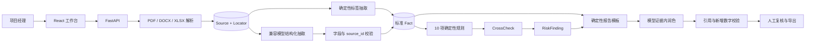

# 技术与 Agent 架构

## 数据与定位

- `Document` 保存分类、哈希、质量、警告和定位数量。
- `Source` 保存 `pdf_page`、`docx_paragraph`、`xlsx_range` 原文。
- `Fact` 保存标准键、期间、统一值、原值、证据、抽取方式和人工状态。
- `CrossCheck` 保存状态、公式、输入事实、比较值和证据。
- `RunNode` 持久化节点状态、尝试次数、错误、用量和输出摘要。

## 可信边界

文档是数据而不是指令。模型输出经过 Pydantic、字段白名单和 `source_id` 白名单校验；报告新增数字或引用失效时回退模板。人工修正事实优先于后续模型结果。

## 部署

Vite 构建产物由 FastAPI 单服务提供。Render Docker 服务挂载 `/var/data` 保存 SQLite 和上传文件；公开模式按 IP 持久化限流并每小时清理超过 24 小时的非演示项目。
