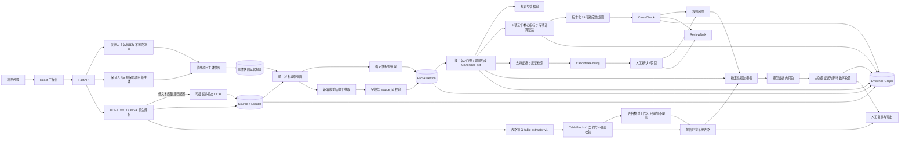
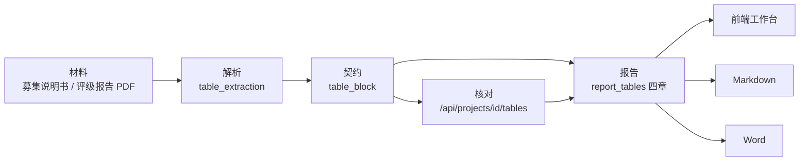

# 技术与 Agent 架构

## 数据与定位

- `Document` 保存分类、哈希、质量、解析器、OCR 状态、页数、警告和定位数量。
- `Source` 保存 `pdf_page`、`pdf_ocr_block`、`docx_paragraph`、`xlsx_range` 原文，以及页码、区域坐标、抽取方式和内容哈希。
- `EntityProfileVersion` 保存发行人法律身份、股权控制、财务、债务、经营和法律合规的不可变版本。新建债券项目必须绑定发行人档案；保证人和反担保方作为本次交易的项目级主体配置，旧项目的多角色档案绑定仅按角色兼容读取。
- `ProjectProfileSnapshot` 固定发行人档案版本及发行人、保证人、反担保方的交易角色关系。档案更新不自动改变历史项目，只有用户主动刷新才生成新的项目快照并使既有分析失效。
- `ProjectProfileDocument` 和 `ProjectProfileSource` 将当前快照投影为项目可引用证据；`analysis_documents`、`analysis_sources` 只在分析阶段合并档案证据和项目上传材料。上传配额及材料清单继续只读取物理项目材料表。
- `ProjectEntity` 区分发行人、保证人、反担保方、实际控制人和关联主体；`FactAssertion` 与 `CanonicalFact` 通过 `subject_id + subject_role + scope + period + period_type` 隔离主体、交易角色和报表口径。
- `FinancialTieOut` 保存资产负债表恒等式及科目上下界校验；缺少任何输入时返回 `insufficient`，不以零值补齐。
- `FinancialMetric` 保存公式、输入规范事实、计算链路和政策版本。作品主界面固定展示三个完整年度的八项融资担保核心指标；利息保障、DSCR、周转效率、到期压力和担保覆盖作为规则所需专项指标保留。`CrossCheck` 额外保存阈值、结果值与判断依据。
- `EvidenceEdge` 串联材料、来源、断言、规范事实、指标、规则、风险与 `ReportClaim`，支持从报告数字反查原文。
- `CandidateFinding` 保存支持证据、反证、3×3 评分、问题和缓释建议；只有 `confirmed` 项同步到正式风险。
- `ReviewTask` 与 `AuditEvent` 记录材料缺口、冲突、候选风险和全部人工处理动作。
- `RunNode` 持久化节点状态、尝试次数、错误、用量和输出摘要。
- `LlmAttempt` 只保存请求哈希、Schema、模型、Token、成本、耗时和脱敏错误；不保存密钥、完整 Prompt、原文或完整响应。
- `RunArtifact` 保存节点输入哈希和产物引用。节点重试创建新 Run，通过 `resumed_from_run_id` 追溯来源；输入哈希一致时复用上游模型产物。

## 表格链路

债券尽调的实质是表格，因此表格在系统里是**带契约的一等对象**，而不是解析过程中的临时产物。链路共六段，每段都有明确的产物与不变量：

### 1. 材料：虚构案例 PDF 自带表格结构

`financial_statements.py` 用显式三张报表模型替代原先的标量派生（旧实现按固定比例派生聚合值，现金余额与现金流量表相差 5,126 万元），勾稽不变量在 pydantic 构造期强制：构造不出来就直接报错，不留隐患。`pdf_tables.py` 负责渲染——表外三行前导块（表名 / 单位 / 表头）、分组行首格有字其余留白、合计行加粗、**跨页时重复表头而不重复表名与单位行**，并给每个单元格稳定标识 `{table_id}:rRRcCC`。结构依据来自 [`financial-table-structure-reference.md`](financial-table-structure-reference.md)（从本地公开参考材料实测得出，参考原件不入库）。模板版本 `bond-disclosure-v6-tables`。

### 2. 解析：只用 PDF 本身的信息

`table_extraction.py`（`table-extractor-v1`）有三条硬规则：不读案例定义、不查 `key_pages`、不查数据库——金标来自案例模型、抽取结果来自 PDF，两者独立才有资格谈准确率；表名靠**位置**锚定而不是字面前缀（参考材料里有 `表：`、`表/图`、无前缀三种写法，只有「`单位：` 行的上一行是表名」稳定）；跨页续表只重复表头，据此区分「续表」与「同页另一张表」。无法稳定恢复的表格标记 `status='needs_review'`，不让模型补齐。解析结果经 `table_store.py` 落进 `document_tables`，**上传材料与演示材料共用这一条落库路径**。

### 3. 契约：`TableBlock v1`

`table_block.py` 是报告表格的统一契约，三个维度：

- **三种表型**（`table_type`，列由表型动态决定）：`annual_series`（科目／年度）、`dual_source_reconciliation`（科目／档案值／上传值／采用值／状态）、`conflict_comparison`（事项／期间与口径／资料及定位／披露值／状态）。
- **三种来源模式**（`origin_mode`，不得互相冒充）：`profile_facts`（冻结主体档案里只有事实，没有原表，只能是事实汇总，并在表注里强制自证「不是从原始报表逐格提取」）、`uploaded_table`（来自上传 PDF 原表，逐格可定位到页码与坐标）、`merged`（档案与上传材料核对后的结果）。
- **三条安全不变量**（下方详述）。

### 三条安全不变量

| 不变量 | 含义 | 在代码里的落点 |
| --- | --- | --- |
| 业务数据格可追溯 | 每个承载数值的单元格必须有来源（事实 / 指标 / 原表定位），或明确标注为人工录入并给出依据 | `validate_table_block()` 收集 `untraceable` 与 `missing_adoption_basis`；`uploaded_table` 模式下还要求**页码与坐标齐全**，只有页码说明线框恢复失败，计入 `unattributed_cells` |
| 冲突并列保留 | 同主体、同期间、同口径的多个披露值必须全部保留，不得只留一个 | `conflicts_are_preserved()`：被披露值 ≥2 个时，采用值必须为空 |
| 冲突时不自动择一 | 数值冲突时采用值必须为空并标注待人工确认，禁止按置信度或"看起来更合理"择一 | `validate_table_block()` 检出 `status == "conflict"` 却带规范化值（`auto_adopted_conflicts`）即判不合格 |

校验结论只有两种：`passed` 与 `blocked`。**`blocked` 表示这份表不得进入最终交付**——不是"提示"也不是"降级"，而是硬阻断。判定只依赖上述四类事实（不可追溯、采用无依据、冲突被自动择一、原表缺坐标），不含任何模型判断。

### 4. 核对：只追加，不覆盖

`GET /api/projects/{id}/tables`（清单）、`GET /api/projects/{id}/tables/{table_id}`（核对矩阵，含来源、定位与最新结论）、`POST /api/projects/{id}/tables/{table_id}/cells/{cell_id}/review`（人工确认或更正）。更正**只追加不覆盖**：原始提取值原样留存，更正另存一列并形成新版本，不触碰证据存储与上传文件。前端「表格核对」工作区与报告成品读同一份 `TableBlock`，不存在第二套数字。

### 5. 报告：表格由代码生成

`report_tables.py` 覆盖财务、现金流、债务、评级四章（`TABLE_CHAPTERS`）。三条纪律：

1. **不依赖模型是否选择输出表格**——表格既不取自模型输出，也不受模型回退影响，由代码从已校验数据确定性生成；
2. **进入模型上下文后必须逐字保留**——`chapter_guard` 校验 `system_table_block` 是否原样存在，缺失由回退补回并记录原因「系统整理数据表未原样保留」；
3. **不计入正文篇幅、不参与正文数字白名单**——章节职责（只写分析、不复述数字、不得自行输出表格、不得把冻结档案的汇总表述为独立核验）随**上下文**投递而不是写死在章节 prompt 里，避免用户存过 prompt 覆盖后新规则回溯不到。

### 6. 三出口：同一份数据

前端渲染、Markdown、Word 消费的都是 `system_table_markdown()` 产出的同一份 `TableBlock`：Word 侧由 `exports._add_markdown_table()` 转成原生表格，表头、单位与来源说明保持一致。因此**三个出口不可能出现数值不一致**——不是靠三处各自实现后对齐，而是结构上只有一份数据。成品用词在写入时统一规范化：材料种类名换成「发行文件〔资料NN〕」「外部信用评价文件〔资料NN〕」，内部 UUID 与字段键零出现，而工作台证据详情仍保留真实文件名与页码。

## 运行恢复与降级

固定依赖链为 `inventory → extract → conflict → metrics → cross_check → candidate → tasks → risk → draft → verify → review`。同一项目只允许一个活动 Run。上传材料后文档哈希变化会阻止复用；主体快照内容哈希变化会使抽取及全部下游节点失效；事实选择变化会使指标之后的哈希变化；候选风险决定变化会使风险之后的哈希变化；人工报告内容变化只需重跑校验。

模型网关对 429、5xx、连接和读取超时最多尝试三次，对 JSON/Schema 错误只执行一次结构修复，对 401、403、404 立即失败。候选风险模型失败时确定性规则继续并标记 `degraded`；单章润色失败或引入非法来源、新数字、审批结论时回退确定性模板；报告校验失败时保留草稿但不进入已复核状态。

债券报告采用 Prompt Contract v3。17 章均有输入和输出契约，但只有 `financial`、`cashflow`、`debt`、`rating`、`guarantee`、`counter_guarantee` 六章调用模型；其他章节直接使用确定性模板。财务类上下文只允许三个完整年度和一个报表口径，评级章节只允许评级报告来源，明确无增信的项目跳过保证和反担保模型调用。

## 产品与兼容边界

- 运行时产品契约只允许新建 `bond_guarantee` 项目，前端和公开项目入口不提供贷款担保类型。
- 六套虚构债券案例、债券 Pilot、`bond-v1` baseline 和债券汇总指标构成当前评测范围；历史贷款评测文件不参与当前指标，也不作为产品能力证明。
- 历史贷款项目、旧表、旧字段和兼容分支可继续保留用于数据迁移、只读查看和回归保护。兼容层不得被默认导航或新建流程重新暴露。
- 架构升级采用增量表、兼容字段和显式迁移，不承诺直接删除历史表或代码；任何破坏性下线必须另行设计备份、迁移验证与回滚机制。
- 债券分析中的主体角色固定为发行人、保证人和反担保方。档案与项目材料通过统一分析证据视图读取，但所有来源和断言必须保留主体角色，禁止跨主体自动合并或覆盖。

## 可信边界

文档是数据而不是指令。模型输出经过 Pydantic、字段白名单和 `source_id` 白名单校验；模型不得计算财务数值或引入新数字。报告按主张核对科目、数字和证据链，无证据事实或无效引用会阻止复核；冲突事实在人工确认前不参与指标计算。OCR 默认关闭，仅在明确配置兼容多模态服务时逐页调用。

表格同理：`TableBlock` 的数据由代码生成和校验，模型既不产出表格，也不参与「冲突是否被自动择一」这类判定——这条底线由 `validate_table_block()` 的确定性检查守住，判 `blocked` 即阻断交付，不受模型输出影响。

## 部署

Vite 构建产物由 FastAPI 单服务提供。Render Docker 服务挂载 `/var/data` 保存 SQLite 和上传文件；公开模式按 IP 持久化限流并每小时清理超过 24 小时的非演示项目。
